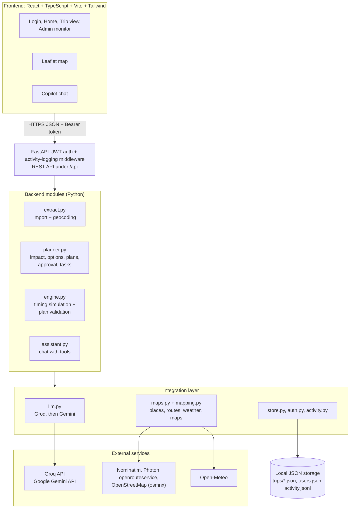
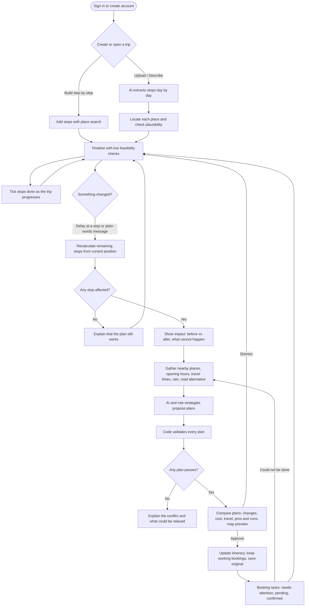
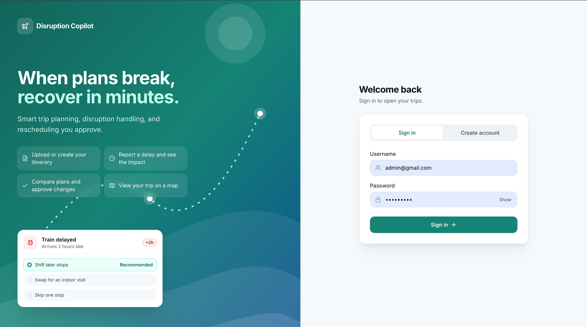
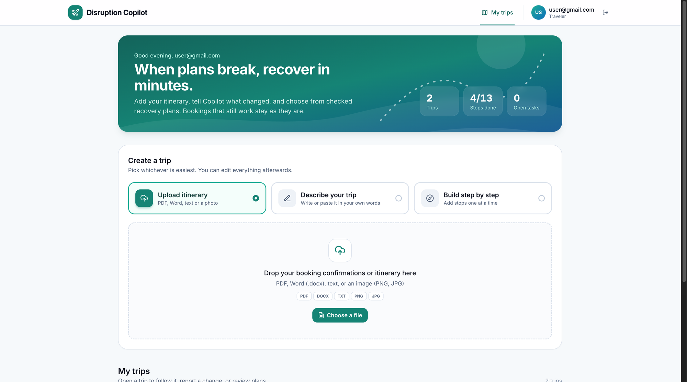
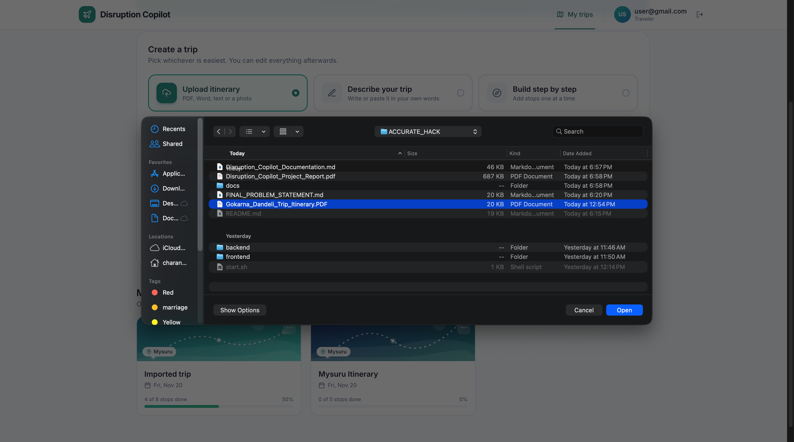
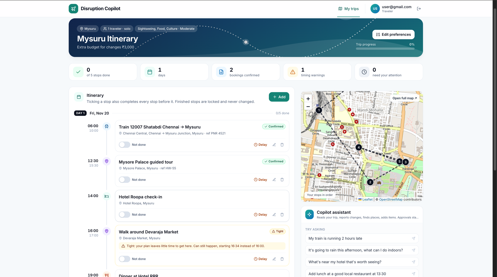
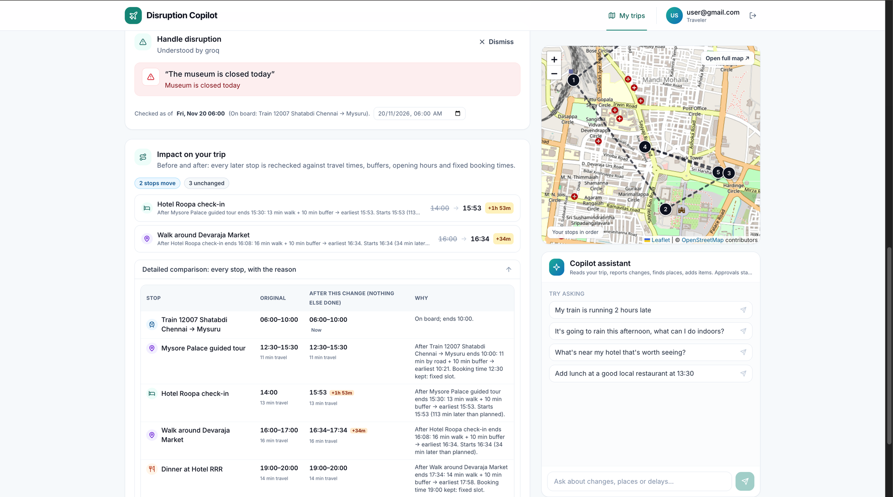
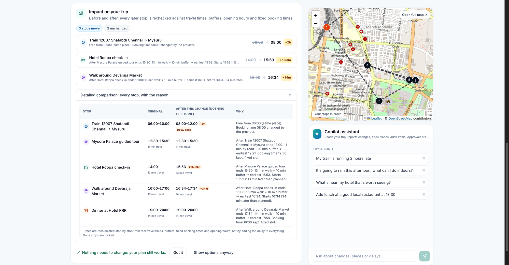
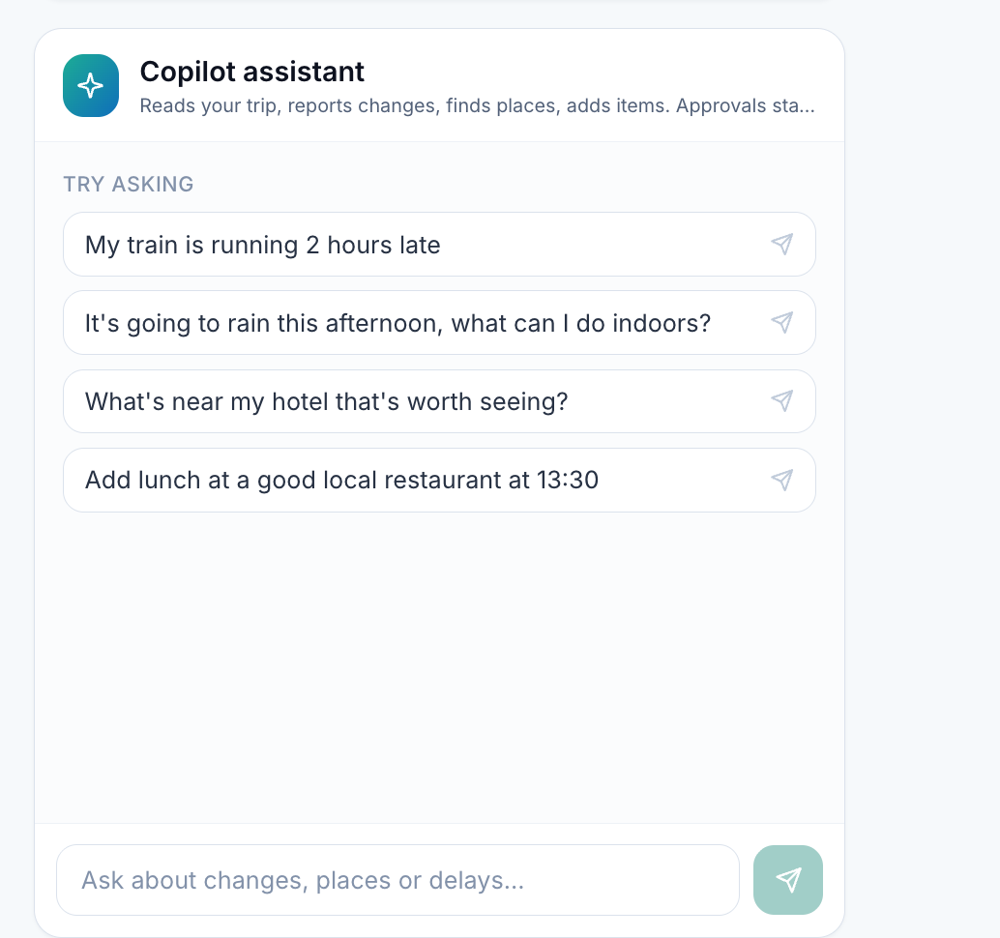
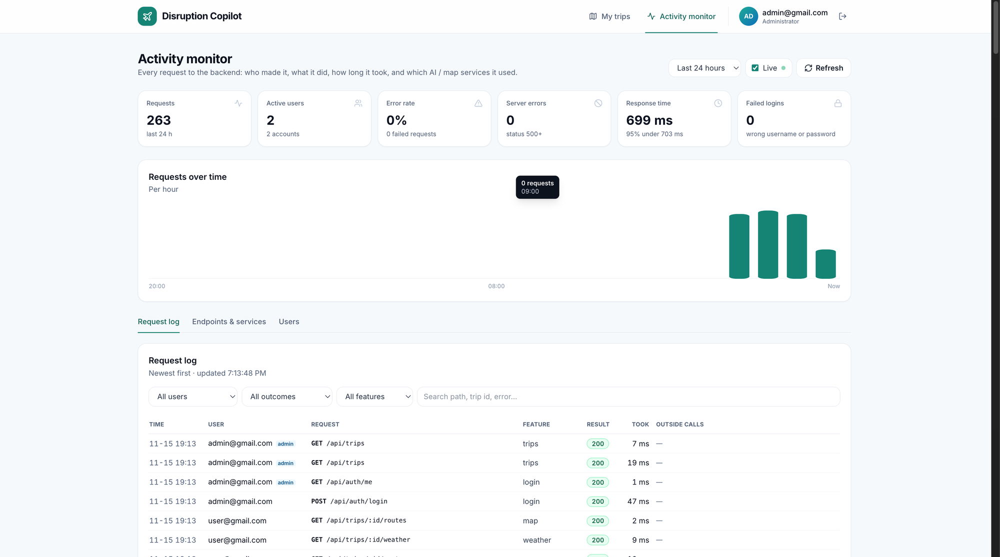

<div class="cover">

# Disruption Copilot

### An AI Travel Assistant for Itinerary Management and Disruption Recovery

**When plans break, recover in minutes.**

<p class="cover-team">TEAM NAME: AI AVENGERS</p>

**Hackathon:** Accurate Hackathon 2026, Problem Statement 2: *Smarter Travel, Better Experience*<br>
**College:** Vallurupalli Nageswara Rao Vignana Jyothi Institute of Engineering & Technology<br>
**Date of submission:** 15 November 2026

| S.No. | Student Name | Roll Number | Branch |
|---|---|---|---|
| 1 | Sai Sri Meghana Bondili | 23071A6709 | DS |
| 2 | Koneti Bhaskar Charan Tej | 23071A0591 | CSE |
| 3 | T. Harshavardhan | 23071A67K0 | DS |
| 4 | Sai Vidith | 23071A67F0 | DS |
| 5 | Kotaru Kshitej | 23071A1226 | IT |
| 6 | Jonnavaram Naga Bharadwaj Reddy | 23071A0584 | CSE |
| 7 | Krishna Pramoditha Kathari | 23071A05G7 | CSE |
| 8 | Mohammed Rehan Khan | 23071A6932 | IoT |

</div>

<div class="pagebreak"></div>

## Table of Contents

1. [Abstract](#1-abstract)
2. [Introduction](#2-introduction)
3. [Problem Statement](#3-problem-statement)
4. [Project Objectives](#4-project-objectives)
5. [Proposed Solution](#5-proposed-solution)
6. [System Architecture](#6-system-architecture)
7. [Technology Stack](#7-technology-stack)
8. [Features and Modules](#8-features-and-modules)
9. [Application Workflow](#9-application-workflow)
10. [AI Integration](#10-ai-integration)
11. [Disruption Handling and Recovery Mechanism](#11-disruption-handling-and-recovery-mechanism)
12. [User Interface](#12-user-interface)
13. [Testing and Validation](#13-testing-and-validation)
14. [Challenges and Limitations](#14-challenges-and-limitations)
15. [Future Scope](#15-future-scope)
16. [Conclusion](#16-conclusion)
17. [References](#17-references)

## 1. Abstract

A trip is a chain of connected commitments: trains, transfers, hotel check-ins, activities and meals. When one link breaks, such as a train arriving late, a cancelled leg, rain or a closed attraction, travelers must work out under pressure which plans are actually affected and what realistic alternatives exist. Today this means switching between maps, booking apps and phone calls, and travelers often cancel plans that still work or miss fixed bookings.

**Disruption Copilot** is a web application that helps travelers manage an itinerary and recover from disruptions. Users import a trip from a PDF, Word document, text or image, describe it in natural language, or build it stop by stop. Every place is located on OpenStreetMap, and the itinerary is shown as a day-by-day timeline with progress tracking and live feasibility checks. When something changes, the user reports a delay at a specific stop or describes the change in plain words. The system recalculates every remaining stop from the traveler's current position. It gathers real nearby alternatives with opening hours and travel times, and offers two to three recovery plans. A large language model (Groq, with Google Gemini as backup) interprets documents and messages and proposes plans. Deterministic code validates every plan against travel times, opening hours, budget, must-do stops, protected bookings and completed stops. Nothing changes until the user approves a plan, and resulting booking changes are tracked as tasks. The application also provides JWT-based accounts with private trips, an AI assistant with tools, interactive maps and an administrator activity monitor. It is supported by 52 automated tests.

## 2. Introduction

Travel itinerary management covers planning, recording and following the sequence of commitments that make up a journey. Modern trips often combine independently booked services, such as rail tickets, road transfers, hotels, guided tours and restaurant reservations, each with its own timings and rules. Itineraries are typically shared as PDF documents, booking e-mails or messages, and each commitment depends on the previous one being on time.

This dependency makes itineraries fragile. A delay early in the day pushes back every later stop, may make a booked activity unreachable, and may leave too little time to travel between places before they close. Some commitments are unaffected: a hotel with an evening check-in window, for example, does not fail because a train is two hours late. A traveler needs to distinguish what is really broken from what is merely shifted, and then choose a realistic alternative that respects travel times, opening hours, budget and personal priorities.

Disruption Copilot addresses this need. It combines an itinerary manager, a deterministic scheduling engine, open map and weather data, and a large language model into a single application that tells the traveler what a disruption affects, what can realistically be done, and what each option costs them, while leaving the final decision with the traveler.

## 3. Problem Statement

**Hackathon track:** Problem Statement 2, *Smarter Travel, Better Experience*: "How might we simplify trip planning and journeys by bringing routes, timings and traveler needs together into one seamless, personalized experience?"

When a disruption occurs, a traveler holding several independent bookings faces four questions:

1. **What does this disruption actually affect?** Which stops become late, tight or impossible, and which are still fine?
2. **What recovery options are feasible?** Which nearby alternatives are open, and is there enough time to travel to them?
3. **What does each option cost or make the traveler give up?** Extra money, dropped or shortened activities, a longer day.
4. **Which changes are confirmed, pending, or still need action?** Which booking changes have actually been completed?

The specific challenges are:

- **Unstructured itineraries:** trips arrive as PDFs, documents, images or messages, not structured data.
- **Ambiguous locations:** place names in itineraries are often generic ("campsite", "railway station") or shared by places in other towns.
- **Cascading timing effects:** a delay propagates through later stops differently depending on travel times, buffers, fixed bookings and opening hours.
- **Unreliable automated suggestions:** an AI model alone can propose plans that are unreachable, closed or over budget.
- **Loss of control:** the traveler must keep the final decision, and completed stops and working bookings must not be changed silently.

**How might we** help travelers recover from disruptions by identifying which plans are actually affected and proposing feasible, personalized recovery plans? And how do we track the changes they approve, while keeping bookings that still work and stops already completed?

## 4. Project Objectives

1. Allow users to **create itineraries** by uploading documents and images, describing a trip in natural language, or building it step by step.
2. **Locate every stop accurately** on a map, rejecting same-name places in the wrong town, state or country.
3. Present the itinerary as a **day-by-day timeline** with progress tracking and live feasibility checks.
4. Let users **report disruptions** either at a specific stop or in natural language.
5. **Identify the actual impact** of a disruption by recalculating every remaining stop from the traveler's current position.
6. Generate **two to three recovery plans** using real nearby alternatives, and **validate every plan with deterministic code** before it is shown.
7. Require **explicit user approval** before any change, protect completed stops and working bookings, and track booking changes until they are confirmed.
8. Provide **secure accounts** with private trips, and an **administrator activity monitor** that shows how requests are processed.

## 5. Proposed Solution

Disruption Copilot is a full-stack web application with a React frontend and a FastAPI backend. The solution is built on one principle: **the AI suggests, the code decides.**

- **Understanding:** a large language model reads itinerary documents and images and interprets natural-language messages, converting them into structured data.
- **Facts from open data:** place locations, nearby alternatives, opening hours, road travel times and rain forecasts come from OpenStreetMap-based services and Open-Meteo, never from the AI.
- **Deterministic decisions:** a scheduling engine computes when each stop can really happen, classifies the impact of a change, and validates every candidate plan against hard limits.
- **Human control:** the traveler reviews the impact, compares plans side by side, and approves one. Completed stops are locked, and bookings that still work are kept.

From the traveler's perspective, the flow is: **sign in → create or open a trip → follow the timeline → report a change → review the impact → compare checked plans → approve → track booking tasks.**

## 6. System Architecture

The system follows a client–server architecture. The single-page React application communicates with the FastAPI backend over a JSON REST API under `/api`. The Vite development server proxies these requests to the backend. All requests except login, registration and status pass through an authentication and activity-logging middleware. Data is stored locally as JSON files.



*Figure 6.1: System architecture of Disruption Copilot.*

### 6.1 Backend modules

| Module | Responsibility |
|---|---|
| `main.py` | API routes, request models, authentication and activity-logging middleware, trip view composition |
| `auth.py` | User accounts, PBKDF2 password hashing, JWT issue and verification, request context |
| `activity.py` | Request activity log, filtering and aggregate statistics for the admin monitor |
| `extract.py` | File-to-text conversion (PDF, DOCX, text, image), AI extraction day by day, place location with plausibility checks |
| `engine.py` | Item normalisation, durations, travel legs, timing simulation, impact classification, plan validation |
| `planner.py` | Change interpretation, impact recalculation, option gathering, AI and rule-based plan strategies, ranking, approval, booking tasks, progress (done) handling |
| `assistant.py` | Chat assistant with tool calling (read trip, report change, find places, add items, set preferences) |
| `llm.py` | OpenAI-compatible calls to Groq and Gemini, JSON mode, retries on rate limits, provider fallback |
| `maps.py` | Geocoding, place search, nearby places, opening hours, travel times, road alternatives, rain forecast, caching |
| `mapping.py` | Road route lines for the in-app map and the full-screen folium map |
| `store.py` | Trip persistence as JSON files and per-user trip listing |

### 6.2 Data storage

| Store | Format | Contents |
|---|---|---|
| `backend/data/trips/` | One JSON file per trip | Owner, items (stops), preferences, disruptions with impact and plans, booking tasks, baseline (original plan), trip log |
| `backend/data/users.json` | JSON | User id, username, role, salted password hash, creation and last-login times |
| `backend/data/activity.jsonl` | JSON lines | One record per API request (most recent 20,000) |
| `backend/data/.jwt_secret` | Text | Token-signing secret, created automatically unless `JWT_SECRET` is set |

### 6.3 REST API summary

| Area | Endpoints |
|---|---|
| Authentication | `POST /api/auth/register`, `POST /api/auth/login`, `GET /api/auth/me` |
| Trips | `GET/POST /api/trips`, `POST /api/trips/import`, `POST /api/trips/import-text`, `GET/PATCH/DELETE /api/trips/{id}` |
| Itinerary items | `POST /api/trips/{id}/items`, `PUT/DELETE /api/trips/{id}/items/{item}`, `POST /api/trips/{id}/items/{item}/done` |
| Disruptions | `POST /api/trips/{id}/changes`, `POST …/changes/delay`, `PUT …/changes/{d}/delay`, `PUT …/changes/{d}`, `POST …/changes/{d}/dismiss` |
| Recovery plans | `POST …/changes/{d}/plans`, `POST …/changes/{d}/plans/{p}/approve` |
| Booking tasks | `POST /api/trips/{id}/actions/{a}`, `POST /api/trips/{id}/actions/{a}/replan` |
| Map and context | `GET /api/trips/{id}/routes`, `GET /api/trips/{id}/map.html`, `GET /api/trips/{id}/weather`, `GET /api/places/search` |
| Assistant | `POST /api/trips/{id}/chat` |
| Administration | `GET /api/admin/activity`, `GET /api/admin/stats`, `GET /api/admin/users` |
| Status | `GET /api/status` |

## 7. Technology Stack

| Layer | Technology | Purpose |
|---|---|---|
| Frontend framework | React 18.3, TypeScript 5.6 | Single-page user interface |
| Build tool | Vite 5.4 | Development server, API proxy, production build |
| Styling | Tailwind CSS 3.4 | Design system: colours, spacing, responsive layout, animations |
| Maps (client) | Leaflet 1.9, react-leaflet 4.2 | Interactive trip map with routes, stops and plan previews |
| Backend framework | Python, FastAPI, Uvicorn | REST API and middleware |
| Authentication | PyJWT (HS256), PBKDF2-SHA256 (Python standard library) | Login tokens and password hashing |
| HTTP client | httpx | Calls to AI providers and web services |
| Documents | pypdf; DOCX read directly from its XML | Text extraction from PDF and Word files |
| AI (primary) | Groq API, model `openai/gpt-oss-120b` | Itinerary extraction, change interpretation, plan proposals, chat |
| AI (backup and vision) | Google Gemini API, model `gemini-flash-lite-latest` | Fallback AI and itinerary extraction from images |
| Geocoding | geopy with OpenStreetMap Nominatim | Locating imported places |
| Place search | Photon (komoot) | Search-as-you-type place picker and fallback search |
| Routing and POIs | openrouteservice (Python client) | Road travel times, route geometry, nearby points of interest, road alternatives |
| Opening hours | osmnx (Overpass API) | Additional opening hours from OpenStreetMap |
| Static maps | folium | Full-screen shareable trip and plan map |
| Weather | Open-Meteo | Hourly rain forecast for outdoor stops |
| Configuration | python-dotenv, certifi | `.env` settings, TLS certificates |
| Storage | JSON files | Trips, users and activity log |
| Testing | pytest, FastAPI TestClient | 52 automated offline tests |

## 8. Features and Modules

### 8.1 Authentication and user management

| | |
|---|---|
| **Input** | Username and password (sign in or create account) |
| **Processing** | Validates the username (3–40 characters) and password (at least 6 characters). Stores a salted PBKDF2-SHA256 hash (200,000 iterations). Issues an HS256 JWT valid for 24 hours. The middleware verifies the token on every request and rejects expired, forged or orphaned tokens. The first account becomes administrator, unless `ADMIN_USERNAME`/`ADMIN_PASSWORD` are configured. |
| **Output** | Token and user profile; each user sees only their own trips (other users' trips return "Trip not found"); administrators can open the activity monitor |

### 8.2 Itinerary creation and import

| | |
|---|---|
| **Input** | A PDF, DOCX, TXT/MD/EML/HTML, or PNG/JPG/WEBP file; or a natural-language description; or a trip name and city for step-by-step entry |
| **Processing** | Text is extracted from the document; image uploads go to Gemini's vision model. Long itineraries are split into day sections and extracted one day at a time, with the whole document as context. Labels such as *SUGGESTED* and *ADVERTISED* are read from the source lines, so suggested times stay flexible while advertised or booked times are fixed. Duplicate arrival markers and items outside a section's date are removed. Days the AI failed on are logged. |
| **Output** | A structured trip: transport, stays, activities, meals and other items with times, places, booking provider and reference, priority and notes |

### 8.3 Place location (geocoding)

| | |
|---|---|
| **Input** | Place name and area for every stop, plus the journey's other end for transport |
| **Processing** | Finds the town first, preferring the town written in the place's own name. Accepts a candidate only if it is in the trip's country and reachable from the previous located stop in the available time (60 km plus 90 km per travel hour). Ranks candidates by exact name match, then by nearness. States and countries are never used as towns. Generic names without a known town fall back to the town centre, or to the previous stop, and are marked **approximate**. |
| **Output** | Coordinates and address for each stop, with approximate or unresolved stops listed in the trip log |

### 8.4 Timeline and progress tracking

| | |
|---|---|
| **Input** | Done toggles, optional actual finish times, item edits |
| **Processing** | Ticking a stop marks all earlier stops as done; unticking a stop reopens all later stops. Completed stops are locked and never rescheduled. A delay reported on a completed stop is ignored, with an explanation. The live feasibility view simulates the remaining stops and flags **Tight** (flexible stop starts later) or **Plan conflict** (fixed stop unreachable), with the reason. |
| **Output** | Day picker, connected timeline, "You are here" marker, progress bar, summary tiles, booking status per stop |

### 8.5 Disruption reporting and impact analysis

| | |
|---|---|
| **Input** | A delay at a stop (minutes; runs over, starts late, or arrives late), or a natural-language message with an optional "as of" time |
| **Processing** | The message is mapped onto stops (delay, cancel, closed, reschedule, skip), with rain windows and new personal commitments. The engine re-simulates the itinerary from the traveler's current position and compares it with the original schedule. The comparison is relative to the traveler's own plan, so problems that already existed are labelled *not caused by this change*. |
| **Output** | Impact per stop: unaffected, shifts later, at risk, affected (cannot happen), in progress, completed; a before-and-after list and a detailed table with reasons |

### 8.6 Alternatives and recovery plan generation

| | |
|---|---|
| **Input** | The analysed disruption, the trip and the traveler's preferences |
| **Processing** | Gathers nearby points of interest matching the traveler's interests within 2 km of affected stops (indoor only during rain). They come with opening hours and travel times, plus a road alternative for cancelled transport. Plans come from the AI and from built-in strategies (shift later, shorten, reorder, postpone lower priorities, swap for a nearby place, take it easy). Every plan is validated and ranked. |
| **Output** | Up to three or four validated plans, with summary, schedule changes (moved, shortened, reordered, postponed, new, dropped), checks, pros and cons, extra cost, travel time and end of day; rejected plans with reasons |

### 8.7 Approval and booking task tracking

| | |
|---|---|
| **Input** | Approval of a specific plan, or dismissal of the change; task status updates |
| **Processing** | Saves the original itinerary as a baseline, applies the plan's moves, additions and removals, and creates booking tasks for changes to booked items. A failed task triggers a new plan that keeps already-confirmed changes. |
| **Output** | Updated itinerary, a "Compare with original" view, and tasks moving through **Needs your attention → Pending → Confirmed**, or **Couldn't be done → Find another plan** |

### 8.8 Copilot assistant

| | |
|---|---|
| **Input** | Chat messages with conversation history |
| **Processing** | The model can call six tools: `get_trip`, `report_change`, `find_places`, `add_item`, `add_items_from_text`, `set_preferences` |
| **Output** | Natural-language replies, with the tools used and the provider shown. It cannot approve plans or confirm bookings. |

### 8.9 Maps and weather

| | |
|---|---|
| **Input** | Trip stops, the open disruption and a focused plan |
| **Processing** | Road geometry between stops from openrouteservice (straight lines as fallback). Markers are coloured by status, and a plan preview highlights new, moved and dropped stops. A full-screen folium map is also available. Open-Meteo rain forecasts are checked against outdoor stops. |
| **Output** | Interactive map, "Open full map" page, and a "Plan around the rain" prompt when rain is forecast during outdoor stops |

### 8.10 Administrator activity monitor

| | |
|---|---|
| **Input** | API traffic; admin filters (user, outcome, feature, search, time window) |
| **Processing** | The middleware records each request: user, method, route, feature area, status code, duration, error detail, notes (e.g. items imported, plans offered), and outside calls per service with counts, time and failures. The monitor's own refresh requests are not logged. |
| **Output** | Summary tiles (requests, active users, error rate, server errors, response time, failed logins), requests-over-time chart, request log with details, busiest endpoints, per-service performance, per-user activity |

## 9. Application Workflow



*Figure 9.1: Application workflow as implemented.*

1. **Create an itinerary.** The user uploads a file, describes the trip, or builds it step by step. Imported stops are located on the map, and uncertain locations are marked approximate.
2. **Track activities.** The user ticks stops as they are completed (earlier stops are completed automatically) and corrects actual finish times where needed. The timeline shows the next stop, progress and any warnings.
3. **Report a disruption.** The user presses **Delay** on a stop or describes the change under **Something changed?** using one of six categories or free text.
4. **Review the impact.** The impact view lists the stops that change (old time → new time), stops that cannot happen, and the reason for each.
5. **Review plans.** **Find recovery plans** produces validated plans. Each can be compared side by side with the original and the no-action outcome, and previewed on the map.
6. **Approve.** The user approves one plan or dismisses the change. On approval, the itinerary updates and booking changes become tasks to complete and confirm.

## 10. AI Integration

### 10.1 Services and roles

| Service | Model | Role |
|---|---|---|
| Groq (primary) | `openai/gpt-oss-120b` | Itinerary extraction from text, change interpretation, plan proposals, chat with tools |
| Google Gemini (backup) | `gemini-flash-lite-latest` | Used when Groq fails; the only provider used for image uploads (vision) |

Both providers are called through OpenAI-compatible chat-completion endpoints. The provider order is configurable (`LLM_PROVIDER_ORDER`).

### 10.2 Processing workflow

1. **Structured requests:** extraction, change interpretation and plan proposals use JSON mode with explicit system prompts. Each request sets its own token limit: 800 for itinerary metadata, 3,500 per day section.
2. **Resilience:**
   - On HTTP 429 or 503 the call waits (respecting `retry-after`, at most 20 s) and retries.
   - Failing requests are retried once without strict JSON mode, then the next provider is tried.
   - If every provider fails, rule-based fallbacks take over: keyword-based change interpretation and rule-based plan strategies.
3. **Day-by-day extraction:** long itineraries are processed one day section at a time, with the whole document as context and the previous day's end location carried forward. Failed sections are retried and, if still failing, reported.
4. **Tool calling:** the chat assistant receives tool definitions and can read the trip, report changes, search places, add items and update preferences. The backend executes each tool and returns the result to the model.

### 10.3 How AI output is handled

AI output is treated as a proposal, never as fact:

- **Extracted items are cleaned before use:**
  - non-dictionary items are discarded;
  - items outside a section's date are dropped;
  - time labels found in the source text override the model's guess.
- **Every place is located with the open geocoders** and checked for plausibility. The model's coordinates are never used.
- **Interpreted changes are only accepted for real stops:** they must refer to existing item IDs, and an "as of" time outside the trip's dates is ignored.
- **AI-proposed plans are validated by the same deterministic code as rule-based plans.** They may only use real options provided to the model, and plans that fail any check are rejected with the reason shown.
- **The assistant cannot approve plans or confirm bookings;** these remain user actions.

## 11. Disruption Handling and Recovery Mechanism

### 11.1 Delay reporting

A delay can be reported directly on a stop with a size of 1 minute to 24 hours and a mode:
- **Runs over:** the stop ends later.
- **Starts late:** the stop begins later.
- **Arrives late:** used for transport.
- **Check in later:** used for stays.

The reported delay can then be resized (−15, −5, +5, +15 min); everything is recalculated from the original times. Delays can also be described in natural language, together with cancellations, closures, rain windows and new personal commitments.

### 11.2 Identifying affected activities

The engine sorts stops in booked sequence and simulates them from the "as of" time:

- **Ticked stops are history:** they fix the traveler's position and time, and are never rescheduled.
- **Where the traveler is now:** the stop the reported change refers to, or a fixed booking that is under way, sets the current position. Unticked stops before it whose time has passed are treated as completed for planning (the traveler's ticks are not changed).
- **Unticked flexible stops after that point** remain to do even if their planned time has passed, because the traveler may simply be running late.

### 11.3 Time recalculation

For each remaining stop the engine computes the earliest possible start:

- **Base rule:** the earliest start is the end of the previous stop, plus the travel time between the two locations, plus a buffer.
- **Buffers:** 10 minutes, or 20 minutes before transport.
- **Travel time:** road or walking time from openrouteservice, with a city-traffic factor and a cab allowance, or a distance-based estimate.
- **No invented travel:**
  - two approximate locations in the same area are treated as the same place;
  - a transfer without a stated origin departs from the traveler's current location;
  - a journey whose recorded start is mislocated onto its own destination departs from where the traveler is.
- **Fixed stops** keep their booked time.
- **Flexible stops** start at the later of their planned time and their earliest possible time, within a type-specific window (for example, 240 minutes for activities, 90 for meals). Opening hours are checked at the new time.
- **Stays** are treated as a check-in window: arriving later is fine.

### 11.4 Schedule conflict detection

Each stop is classified as one of:

- **Unaffected:** starts on time, or within 30 minutes.
- **Shifts later:** a flexible stop more than 30 minutes late.
- **At risk:** outdoors during forecast or reported rain.
- **Affected:** a fixed stop is unreachable, a flexible stop no longer fits its window, or the place is closed or cancelled.

In the timeline these appear as **Tight** and **Plan conflict** (a fixed stop that cannot be reached).

The impact is compared with a simulation of the traveler's own plan at the same moment:
- A stop that was already tight is reported as *not caused by this change*.
- A stop that cannot happen in either case stays marked as a problem, labelled *already a problem in your own plan*.

### 11.5 Alternative itinerary generation

1. **Options:** nearby points of interest within 2 km of affected stops, matching the traveler's interests (indoor only during rain), with opening hours and travel times. A road alternative is added for cancelled transport.
2. **Strategies:** the AI proposes plans using only these options. Built-in strategies add:
   - **Shift and keep what fits:** flexible stops move later, and anything that no longer fits is dropped.
   - **Shorten:** trim lower-priority stops to their minimum duration, or skip one, to rescue a booking.
   - **Reorder:** try permutations of stops to cut travel.
   - **Postpone lower priorities:** move them later in the day.
   - **Swap for a nearby place:** replace an affected or rained-out stop with an open nearby option.
   - **Take it easy:** keep only bookings and priorities.
3. **Validation (deterministic):** a plan is accepted only if all of the following hold:
   - every stop is reachable in time (small timing issues are repaired, and new stops that do not fit are removed);
   - places are open at the planned times;
   - stops are not shortened below their minimum duration;
   - completed stops are untouched;
   - must-do stops are kept;
   - the extra cost is within the traveler's budget;
   - no outdoor stops fall in rain;
   - no confirmed or pending booking that still works is dropped.
4. **Ranking:** plans are scored by the priorities they keep (must 100, high 30, normal 10, optional 3), plus new stops. Points are subtracted for extra cost, travel time, shortening, postponing and reordering. The best plan is marked **Recommended**; duplicates are removed.

### 11.6 Booking protection

- A plan that drops a confirmed or pending booking that still works is rejected.
- Completed stops are never moved; any plan that would change them fails validation.
- Bookings unaffected by an approved plan remain unchanged. Only changed bookings generate tasks.

### 11.7 User approval

Nothing is changed by analysis or plan generation. The user explicitly approves one plan (from its card or from the comparison view), or dismisses the change. If no plan passes validation, the application explains which checks failed and suggests what could be relaxed (budget, priority, "as of" time).

### 11.8 Itinerary updates

On approval:
- the original itinerary is saved as a baseline (once);
- moved stops receive their new times, with the previous times kept for display;
- new stops are added and dropped stops are cancelled with a reason;
- booking tasks are created for changed bookings;
- the trip log records the change.

A failed task can trigger replanning that keeps already-confirmed changes. **Compare with original** shows the original plan next to the current one.

## 12. User Interface

The interface uses a consistent design system: background `#F8FAFC`, white cards, text `#0F172A`, primary teal `#0D9488`, accent sky `#0284C7`, and borders `#E2E8F0`. It uses the Inter typeface and an outline icon set. Layouts adapt to desktop and mobile widths. Actions are confirmed with toast messages, and loading, empty and error states are shown explicitly.

### 12.1 Login and registration
A split screen. The brand panel shows the headline, four feature highlights and an illustration of a delay becoming a choice of plans. The sign-in card offers *Sign in* and *Create account* tabs, a password visibility toggle and validation messages.



*Figure 12.1: Login and registration screen.*

### 12.2 Home dashboard
A greeting banner with trip statistics (trips, stops done, open tasks) and a **Create a trip** card with three options: Upload itinerary, Describe your trip, Build step by step. **My trips** shows cards with a cover graphic, destination, dates and progress, plus a menu to move or delete a trip. Automated test trips appear in a separate collapsible section.



*Figure 12.2: Home dashboard with trip statistics and trip creation options.*

### 12.3 Trip creation
Drag-and-drop upload with supported formats; natural-language description with an example; step-by-step creation with trip name and main city. Long imports show a progress message.



*Figure 12.3: Trip creation: uploading an itinerary file.*

### 12.4 Trip detail dashboard
A cover header with destination, travelers, interests, pace, budget, **Edit preferences** and a progress bar; summary tiles; a day picker; and the connected timeline. Each stop card shows its time, place, schedule warning, booking status, done switch, Delay, edit and remove actions. The side column holds the interactive map and the Copilot assistant.



*Figure 12.4: Trip detail dashboard with timeline, map and Copilot assistant.*

### 12.5 Disruption reporting and impact
The **Something changed?** card offers a three-step guide, six category tiles, a free-text box, an optional "as of" time and **Check my trip**. After a report, the disruption card shows the change, delay adjustment controls and the current position. The impact card lists the changes as before → after, with a detailed comparison table.



*Figure 12.5: Disruption reported in plain words (“The museum is closed today”) and its impact on the trip.*

### 12.6 Before-and-after comparison and recovery plans
The detailed comparison lists every stop with its original time, its time after the change, and the reason. When the plan still works, the application says so and offers **Got it** or **Show options anyway**; otherwise **Find recovery plans** opens the plan cards. Lettered plan cards (A, B, …) show the **Recommended** label, extra cost, travel time, day end, changed stops with reasons, checks, advantages and disadvantages, and **Map**, **Compare** and **Approve this plan** actions. The comparison dialog shows the original, the outcome if nothing is done, and the plan side by side.



*Figure 12.6: Before-and-after comparison for a 2-hour train delay, with the reason for every stop and the option to view recovery plans.*

### 12.7 Copilot assistant
A chat panel with suggested prompts, message bubbles, a typing indicator, and the provider and tools used shown under each reply.



*Figure 12.7: Copilot assistant with suggested prompts.*

### 12.8 Administrator activity monitor
Six summary tiles, a requests-over-time chart, and tabs for **Request log** (filters, search, expandable details), **Endpoints & services** and **Users**, with **Live** refresh and a time-window selector.



*Figure 12.8: Administrator activity monitor.*

## 13. Testing and Validation

### 13.1 Automated tests

The backend has **52 automated tests** (pytest). They run fully offline: AI is disabled (rule-based fallbacks), travel is estimated from distance, place lookups are replaced by fixtures, and test data is written to temporary folders. Run them with:

```
cd backend && ../.venv/bin/python -m pytest -q
```

| Test file | Tests | Areas covered |
|---|---|---|
| `test_recovery.py` | 12 | Feasibility of a plain itinerary; selective impact of a 3-hour delay; plans validated and keeping unaffected bookings; approval updating the itinerary and creating tasks; rain swapping outdoor stops for indoor ones; closed attractions; honest "no plan" when a must-do is unreachable; small delays needing no change; replanning after a failed booking while keeping confirmed items; cancelled transport; rejection of plans dropping working bookings |
| `test_progress_and_alternatives.py` | 20 | Absorbing an overrun; protection of completed items; done cascade forwards and backwards; actual finish times; delays on done stops ignored; delay resizing from original times; shorten, postpone, reorder and skip strategies; plan explanations and ranking; approval keeping a baseline; hotel delay as late check-in; delays never checked before the latest done time; mid-trip delays treating earlier unticked days as behind the traveler and still producing plans |
| `test_import.py` | 12 | Rejecting same-name places abroad; accepting exact-name places in a nearby town; day sections and time labels; per-day merge and duplicate removal; suggested times flexible; transfers without origin; plan-relative impact; malformed AI replies not crashing the import; overnight stays not drifting to far namesakes; states never used as towns; the town in a place name beating a wrong area label; mislocated journey starts |
| `test_auth.py` | 8 | Login required; first account becomes admin and adopts older trips; per-user trip isolation; wrong passwords, expired and forged tokens; duplicate and weak sign-ups; admin-only monitor with error details and failed logins; outside-call counting; token-in-URL access for the full map |

**Result:** all 52 tests pass. The frontend passes the TypeScript type check and the production build.

### 13.2 Functional validation

During development, the main user journeys were run in a real browser against a copy of the data. The journeys were:
- sign in;
- the three ways to create a trip;
- opening a trip;
- reporting a 60-minute delay on day 3 of a four-day itinerary;
- generating and comparing plans;
- approving a plan;
- using the assistant;
- all admin monitor tabs.

They completed without page errors on desktop and at a 390-pixel mobile width, with no horizontal overflow.

A real four-day itinerary PDF was imported end to end: 33 stops across 4 days, with suggested times flexible and booked trains fixed. Camp stops without an exact map entry were placed approximately in the correct town, and no stop was reported as delayed without a reported change.

### 13.3 Issues found and resolved

| Issue observed | Resolution |
|---|---|
| Generic place names matched same-name places in other states and countries, creating false delays | Town-anchored, country-filtered, time-plausibility checked geocoding with approximate fallback |
| Long PDFs produced only a few stops because the AI output was cut off | Day-by-day extraction with retries and reporting of failed sections |
| A delay reported on day 3 treated unticked days 1–2 as still to do, so no plan could be found | The current position is derived from the reported stop; earlier past stops count as behind the traveler |
| A problem that already existed in the plan was hidden as "fine", so every plan failed validation | Such stops stay marked as problems, labelled "not caused by this change" |
| A return train's start point was placed at its destination, showing a 35-hour road journey | The town in the place name takes priority; journeys that start where they end depart from the current location |
| AI providers occasionally returned rate-limit errors | Retries with back-off and provider fallback |

## 14. Challenges and Limitations

1. **No public timetables:** open data has no train or bus timetables, so a cancelled leg is offered a computed road alternative (distance and time from openrouteservice, fare estimated), and the traveler is asked for replacement times.
2. **Incomplete opening hours:** hours are known only where OpenStreetMap contains them; elsewhere the plan states "confirm before going".
3. **Approximate locations:** stops with generic names may only be located at the town centre. They are clearly marked and can be corrected by editing.
4. **External rate limits:** Nominatim is limited to one request per second, and the free tiers of the AI providers and openrouteservice impose limits (about 2,000 route and 500 POI requests per day for openrouteservice). Importing a long itinerary can therefore take a few minutes. Results are cached.
5. **No direct booking integration:** booking changes are tasks the traveler completes with the provider and confirms in the application; the system does not rebook or pay automatically.
6. **No live status feeds:** disruptions are reported by the traveler; the application does not subscribe to live train or flight status.
7. **Local file storage:** trips, users and logs are JSON files on one server, suitable for a prototype but not for concurrent multi-server use.
8. **AI variability:** model output varies between runs; this is mitigated by validation, cleaning and rule-based fallbacks, but AI-proposed plans may be rejected when they break limits.
9. **Preferences are explicit:** preferences are set by the traveler and are not learned over time.

## 15. Future Scope

The following are **proposed improvements and are not part of the current implementation**:

1. **Live status integration:** subscribe to railway and flight status sources to detect delays automatically.
2. **Booking provider integration:** submit change requests directly to providers and update task status from their responses.
3. **Database migration:** move from JSON files to a relational database (e.g. PostgreSQL) for concurrency, backups and scaling.
4. **Notifications:** alert travelers by e-mail, SMS or push when a stop becomes at risk or a task needs attention.
5. **Public transport routing:** add timetable-based routing where open GTFS data is available.
6. **Shared trips:** let travelling companions view and approve changes on the same trip.
7. **Preference learning:** learn interests and pace from approved and rejected plans.
8. **Offline support and mobile app:** cache the itinerary for use without connectivity.
9. **Multilingual interface** for international travelers.

## 16. Conclusion

Disruption Copilot addresses a practical problem: recovering a trip when one commitment breaks. The implemented application covers the full journey:
- importing real itineraries from documents, images or text;
- locating every stop on open map data;
- following the trip with progress tracking and live feasibility checks;
- reporting disruptions at a stop or in plain words;
- seeing the true impact from the traveler's current position;
- choosing among validated recovery plans built from real nearby alternatives.

The central design decision, that the AI interprets and suggests while deterministic code decides, keeps recommendations grounded in real travel times, opening hours, budgets and booking constraints. Completed stops and working bookings are protected, and every change requires the traveler's explicit approval. Secure accounts, an AI assistant with tools, interactive maps and an administrator activity monitor complete the system. These capabilities have been demonstrated on a real four-day itinerary and are verified by 52 automated tests.

## 17. References

1. FastAPI documentation. https://fastapi.tiangolo.com/
2. Uvicorn documentation. https://www.uvicorn.org/
3. React documentation. https://react.dev/
4. Vite documentation. https://vitejs.dev/
5. Tailwind CSS documentation. https://tailwindcss.com/docs
6. TypeScript documentation. https://www.typescriptlang.org/docs/
7. Leaflet documentation. https://leafletjs.com/reference.html
8. React Leaflet documentation. https://react-leaflet.js.org/
9. PyJWT documentation. https://pyjwt.readthedocs.io/
10. Python `hashlib` (PBKDF2). https://docs.python.org/3/library/hashlib.html
11. HTTPX documentation. https://www.python-httpx.org/
12. pypdf documentation. https://pypdf.readthedocs.io/
13. Groq API documentation. https://console.groq.com/docs
14. Google Gemini API: OpenAI compatibility. https://ai.google.dev/gemini-api/docs/openai
15. geopy documentation. https://geopy.readthedocs.io/
16. Nominatim API and usage policy. https://nominatim.org/release-docs/latest/api/Overview/ and https://operations.osmfoundation.org/policies/nominatim/
17. Photon geocoder. https://photon.komoot.io/
18. openrouteservice API documentation. https://openrouteservice.org/dev/#/api-docs
19. openrouteservice Python client. https://github.com/GIScience/openrouteservice-py
20. OSMnx documentation. https://osmnx.readthedocs.io/
21. folium documentation. https://python-visualization.github.io/folium/
22. Open-Meteo weather forecast API. https://open-meteo.com/en/docs
23. OpenStreetMap copyright and licence. https://www.openstreetmap.org/copyright
24. pytest documentation. https://docs.pytest.org/
25. python-dotenv. https://pypi.org/project/python-dotenv/
