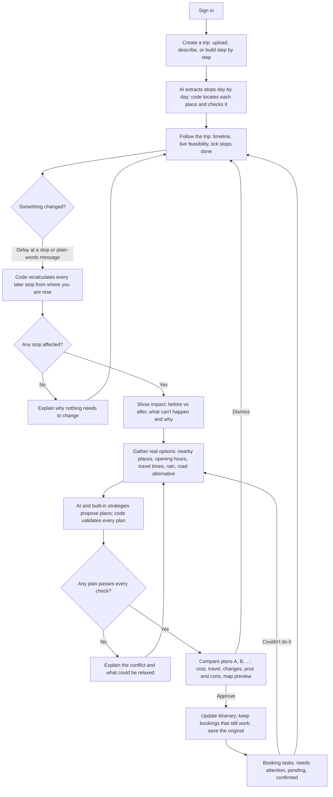

# Disruption Copilot: Travel Recovery Assistant

**Hackathon track:** Problem Statement 2, *Smarter Travel, Better Experience*
("How might we simplify trip planning and journeys by bringing routes, timings and traveler needs together into one seamless, personalized experience?" Example: *one tourist, one package, a better trip*.)

> **When plans break, recover in minutes.**
> Only public data is used: maps and places from OpenStreetMap, weather from Open-Meteo. No Accurate Background data of any kind is used.

---

## 1. Problem statement

### The problem
A trip is a chain of connected commitments: reach the station, board the train, transfer to the hotel, join an activity, catch a sunset, get to dinner. When one link breaks, for example a train arriving two hours late, the traveler has to work out under time pressure, usually on a phone:

- which plans are actually affected and which are still fine;
- what alternatives exist nearby, whether they're open, and whether there's time to get there;
- what each option costs them, or makes them give up;
- and, after making calls, which booking changes are really done and which still need attention.

Today this is done by hand across maps, booking apps, calls and chats. Travelers tend either to over-react (cancelling things that still work) or to under-react (missing a fixed booking).

### Who is affected
An **independent traveler, or a traveler on a customizable package**, who holds separate bookings (train, transfers, stays, activities, meals) and may change each one individually.

### How might we
**How might we help travelers recover from disruptions by identifying which plans are actually affected, proposing feasible and personalized recovery plans, and tracking the changes they approve, while keeping bookings that still work and stops already completed?**

### The four questions every traveler needs answered
1. **What does this disruption actually affect?**
2. **What recovery options are feasible for me?**
3. **What does each option cost me, or make me give up?**
4. **Which changes are confirmed, pending, or still need my action?**

---

## 2. What we built: feature highlights

### 2.1 Bring in any trip
| Feature | What it does |
|---|---|
| **Upload an itinerary** | PDF, Word (.docx), text, or a photo/screenshot (PNG, JPG). The AI extracts trains, transfers, stays, activities, meals, times and booking references. |
| **Long, multi-day itineraries** | Documents are read **one day at a time**, so a 4-day, 33-stop itinerary comes through completely. |
| **Describe it** | Paste booking emails or write the trip in your own words. |
| **Build step by step** | Add each stop by hand with live place search. |
| **Fixed vs flexible times** | Booked or advertised times (a train) are treated as fixed. Times marked *suggested* in the document stay flexible. |
| **Accurate places** | Every stop is located on OpenStreetMap, anchored to its town and checked against how far you could really have travelled. Same-name places in another town, state or country are rejected. If the exact spot isn't mapped, the stop is placed at the town centre and clearly marked **approximate**. |

### 2.2 Follow the trip
| Feature | What it does |
|---|---|
| **Day-by-day timeline** | A day picker and a connected timeline: each stop with its time, place, travel time from the previous stop, and booking status. |
| **Progress tracking** | A done switch on every stop. **Ticking a stop also completes all earlier stops; unticking it reopens the later ones.** The actual finish time can be corrected. |
| **Locked history** | Finished stops are **never rescheduled**. A delay reported on a finished stop is ignored, with an explanation. |
| **"You are here"** | The next stop is highlighted, and the progress bar and summary tiles update live. |
| **Live feasibility** | Every stop is checked in order using real travel times, buffers (10 min, 20 min at stations and airports), fixed vs flexible times, opening hours and check-in windows. Problems show as **Tight** or **Plan conflict**, with the reason. |
| **Status kept separate** | Completion (Done / Not done) is separate from booking status (**Confirmed / Pending / Needs attention**). |
| **Rain warning** | Uses the Open-Meteo forecast; outdoor stops in forecast rain get a "Plan around the rain" shortcut. |

### 2.3 Handle a disruption
| Feature | What it does |
|---|---|
| **Report a delay at a stop** | Pick 15–90 min (or any value). Choose *runs over* or *starts late*; transport is *arrives late* and stays are *check in later*. Adjust it afterwards with −15 / −5 / +5 / +15. |
| **Report anything in plain words** | Quick categories: *Train/flight delayed, Cancelled, Rain, Place closed, Running late, New commitment*, or free text. The AI maps the message onto your stops. |
| **Where you are now** | Stops before the one you report are treated as behind you for planning, even if you haven't ticked them. |
| **Impact, before → after** | Only the stops that change are listed, as *old time → new time* with the difference, plus anything that **can't happen**. A detailed table gives every stop with the exact reason (travel time + buffer → earliest start). |
| **Honest about what caused what** | A problem that already existed in your own plan is labelled *"not caused by this change"*, instead of being blamed on the disruption. |
| **No change when none is needed** | If the plan still works, Copilot says so and changes nothing. |

### 2.4 Real alternatives and checked plans
| Feature | What it does |
|---|---|
| **Real nearby options** | Nearby places matching your interests (indoor only when it rains), from OpenStreetMap via openrouteservice. They come with opening hours where they're mapped, and with real road travel times. |
| **Transport alternative** | A cancelled leg gets a computed road alternative (distance and time from openrouteservice, fare clearly marked as an estimate). |
| **2–3 recovery plans** | Plans come from the AI (Groq, with Gemini as backup) and from built-in strategies: **shift later, shorten, reorder, postpone lower priorities, swap for a nearby place, take it easy**. |
| **Every plan is checked by code** | A plan is shown only if every stop is reachable in time, places are open, it stays within your extra budget, and it keeps must-dos and confirmed bookings that still work. It must never touch a finished stop. Plans that fail are listed with the reason. |
| **Clear comparison** | Plans A, B, … each show a **Recommended** label where it applies, plus extra cost, travel time, when the day ends, and what moves, shortens, gets added or gets dropped (with why). Each has pros and cons. **Compare** puts *original / if nothing is done / with this plan* side by side, and **Map** previews the plan. |
| **No plan when none is safe** | If nothing passes the checks, Copilot explains what got in the way and what you could relax (budget, must-do, "as of" time). |

### 2.5 Approve and track
| Feature | What it does |
|---|---|
| **Nothing changes without approval** | **Approve this plan** updates the itinerary. **Dismiss** keeps everything as it was. |
| **Bookings protected** | Bookings that still work stay unchanged. |
| **Compare with original** | After a change, the original plan is kept and can be compared with the current one. |
| **Booking tasks** | Booking changes become tasks: **Needs your attention → Pending → Confirmed** (with reference). **Couldn't do it** leads to **Find another plan**, which replans while keeping what's already confirmed. |

### 2.6 Copilot assistant and map
| Feature | What it does |
|---|---|
| **Copilot chat** | Reads your trip, reports changes, searches places, and adds stops ("What indoor places are near my hotel?", "Add lunch at 13:30"). Approving plans and confirming bookings stay with you. |
| **Interactive map** | Stops in order with real road routes, nearby options, and plan previews (new / moved / dropped). **Open full map** gives a full-screen folium map. |

### 2.7 Accounts and monitoring
| Feature | What it does |
|---|---|
| **Secure login** | Sign in or create an account. Login uses **JWT** tokens (valid 24 h); passwords are stored only as salted hashes. |
| **Private trips** | Each user sees only their own trips. Automated test trips are kept in a separate section. |
| **Admin Activity monitor** | Every API request is logged: user, endpoint, result, time taken, error message, and **which AI and map services it called** (with timings and failures). |
| **What the admin sees** | Requests, active users, error rate, server errors, response times, failed logins, requests-over-time chart, busiest endpoints, per-service performance, and per-user activity. Live refresh, filters and search. |

### 2.8 Experience and reliability
| Feature | What it does |
|---|---|
| **Clean, responsive design** | Works on desktop and phone, with one consistent design system and icon set. Toast confirmations ("3 earlier stops also marked done", "Plan approved"), loading states, and clear empty and error states. |
| **Resilient AI** | Retries when the AI is rate-limited, falls back from Groq to Gemini, and from there to built-in rules, so the app keeps working without AI. |
| **Tested** | 52 automated tests run fully offline (see §7). |

---

## 3. Workflow

### The steps
1. **Sign in.** Each traveler has their own trips. The admin also sees the activity monitor.
2. **Create a trip** by uploading, describing, or building step by step. Long documents are read day by day, every place is located and sanity-checked, and suggested times stay flexible.
3. **Follow the trip.** Tick stops as you go; ticking a stop completes the ones before it. Finished stops are locked. Warnings show where the plan is tight.
4. **Report a change** with **Delay** on a stop, or in plain words.
5. **See the real impact.** Code recalculates every later stop from where you are now. It shows only what changes, as before → after, and separates problems this change caused from those that already existed.
6. **Get real alternatives.** Nearby places, opening hours, travel times and rain come from open map and weather services, never invented by the AI.
7. **Compare checked plans.** Only plans that pass every check are offered; rejected ones are listed with the reason.
8. **Approve.** The itinerary updates, bookings that still work stay unchanged, and the original is kept for comparison.
9. **Track booking changes** as tasks until each is confirmed. If one fails, find another plan while keeping what's already confirmed.

---

## 4. Who decides what

| The AI (Groq → Gemini) does | The application code does |
|---|---|
| Reads uploaded documents and photos and extracts stops | Locates places and rejects implausible matches |
| Understands plain-words changes and maps them to stops | Calculates travel times, buffers and reachability |
| Proposes candidate plans from the **real options it's given** | Decides impact (still fine / shifts / tight / can't happen) |
| Chats with the traveler using tools | **Validates every plan**: time, opening hours, budget, must-dos, bookings, finished stops |
| Explains trade-offs in plain language | Ranks plans, keeps state, tracks tasks, logs every request |

**Facts never come from the AI.** Places, opening hours, travel times and weather come from OpenStreetMap-based services (Nominatim, Photon, openrouteservice, osmnx) and Open-Meteo. If the AI is unavailable, built-in rules take over.

### Rules the planner follows
- **Hard limits (never broken):** fixed booking times, opening hours, check-in windows, the traveler's extra budget, must-do stops, and stops already done.
- **Preferences (ranking only):** interests, pace, travel group, step-free access, priorities.
- **Unknowns stay unknown:** a missing opening time shows as "confirm before going"; a fare estimate is labelled as an estimate.

---

## 5. Fit with the track themes

| Theme | How Disruption Copilot addresses it |
|---|---|
| **Smart routes** | Real road routes and travel times between stops; recalculates every later stop after a change |
| **Live insights** | Live feasibility on every stop, rain warnings, impact shown stop by stop with reasons |
| **Dynamic & intelligent** | Replans only what's ahead of you, from where you are now, and replans again if a booking change fails |
| **Smarter, faster decisions** | Checked plans side by side: cost, travel, changes, pros and cons, map preview |
| **Personalized** | Interests, pace, group, budget, priorities and step-free access shape the options and ranking |
| **Seamless experience** | One place for the itinerary, map, changes, plans, bookings and an AI assistant |
| **Self-learning** | Not in scope: preferences are set explicitly, not learned |

### What's different about our approach
Itinerary planners and airline assistants already reorganize plans or help rebook flights; we don't claim to be first. Our focus is the part that's still manual for a traveler with several independent bookings:
- **Dependency-aware impact:** only stops that are really broken change, worked out from where you actually are.
- **Checked, not guessed:** every plan is validated by code against real travel times, opening hours, budget and hard limits before it's shown.
- **The traveler stays in control:** nothing changes without approval, finished stops are locked, and booking changes are tracked until confirmed.

---

## 6. Showcase scenarios

| # | Scenario | What to show | Expected result |
|---|---|---|---|
| 1 | **Import a real multi-day itinerary** | Upload `Gokarna_Dandeli_Trip_Itinerary.PDF` | 4 days and 30+ stops on the timeline and map. Suggested times are flexible and the trains fixed. Camp stops are marked *approximate*. No false delays. |
| 2 | **Progress cascade** | Tick a later stop, then untick an earlier one | Earlier stops are ticked automatically; unticking reopens the later ones. Toasts confirm each step. |
| 3 | **Delay mid-trip → plans → approve** | **Delay** 60 min on *Explore Vibhuti Falls* (day 3) → **Find recovery plans** → **Compare** → **Approve** | Earlier days aren't disturbed and only later stops move. The already-unreachable sunset is labelled *not caused by this change*. Checked plans are offered; approving updates the itinerary, and **Compare with original** shows the difference. |
| 4 | **Plain-words disruption** | "My train is running 3 hours late" on the example Mysuru trip | Impact before → after; plans with nearby options and pros and cons |
| 5 | **Rain** | "Heavy rain from 10am to 6pm" | Outdoor stops at risk; indoor alternatives offered |
| 6 | **Small delay** | A 15-min delay with enough slack | "Nothing needs to change", with no plan forced |
| 7 | **Delay on a finished stop** | Tick a stop done, then report a delay on it | Ignored with an explanation; nothing changes |
| 8 | **Booking task flow** | After approving a plan that changes a booking | Needs attention → I've requested it → It's confirmed (with reference), or Couldn't do it → Find another plan |
| 9 | **Copilot** | "What indoor places are near my hotel?" | Real nearby places from the map; can add one to the trip |
| 10 | **Accounts and admin** | Sign in as two users; open **Activity monitor** | Each user sees only their own trips. The admin sees every request with timings, errors and AI/map calls. |

---

## 7. Acceptance criteria (all covered by automated tests or the scenarios above)

| # | Criterion | Verified by |
|---|---|---|
| 1 | Only affected stops change; finished stops are never touched | Tests + Scenario 3 |
| 2 | Every offered plan passes all hard limits; rejected plans show the reason | Tests + Scenario 3 |
| 3 | Bookings that still work are never dropped by a plan | Tests |
| 4 | Approval updates the itinerary; booking changes are tracked separately until confirmed | Tests + Scenario 8 |
| 5 | A small delay creates no changes, with an explanation | Tests + Scenario 6 |
| 6 | No safe plan → the conflict is explained instead of offering a broken plan | Tests |
| 7 | Ticking a stop completes earlier stops; a delay on a finished stop changes nothing | Tests + Scenarios 2 and 7 |
| 8 | A delay mid-trip doesn't treat earlier unticked days as still to do | Tests + Scenario 3 |
| 9 | Import rejects same-name places in the wrong town or country, and reads every day of a long itinerary | Tests + Scenario 1 |
| 10 | Users see only their own trips; expired or forged logins are refused; only admins see the monitor | Tests + Scenario 10 |

The 52 tests run offline: `cd backend && ../.venv/bin/python -m pytest -q`.

---

## 8. Scope and honest limits

**In scope:** any destination and any number of days; upload, describe or build; delays, cancellations, closures, rain and new commitments; real map data; AI and rule-based plans checked by code; approval and booking-task tracking; accounts and admin monitoring.

**Out of scope:** real payments; automatically rebooking with providers (booking changes are tasks the traveler completes and confirms); live train and flight status feeds; learning preferences over time; group packages that need a tour coordinator.

**Limits of open data:**
- There are no public train or bus timetables, so a cancelled leg gets a computed road alternative.
- Opening hours are known only where OpenStreetMap has them.
- Free API tiers apply (openrouteservice about 2,000 route and 500 place requests a day; results are cached).

---

## 9. Tech stack

| Layer | Technology |
|---|---|
| Frontend | React 18, Vite, TypeScript, Tailwind CSS, Leaflet (react-leaflet) |
| Backend | Python, FastAPI, PyJWT |
| AI | Groq (`openai/gpt-oss-120b`), with Google Gemini as backup and for photos; rule-based fallback |
| Maps and places | geopy + Nominatim, Photon, openrouteservice, osmnx, folium |
| Weather | Open-Meteo |
| Storage | Local JSON files (trips, accounts, activity log) |
| Tests | pytest (52 offline tests) |

Setup and usage instructions are in [`README.md`](README.md).

---

## Team

| # | Name | Roll number | Branch |
|---|---|---|---|
| 1 | Sai Sri Meghana Bondili | 23071A6709 | DS |
| 2 | Koneti Bhaskar Charan Tej | 23071A0591 | CSE |
| 3 | T. Harshavardhan | 23071A67K0 | DS |
| 4 | Sai Vidith | 23071A67F0 | DS |
| 5 | Kotaru Kshitej | 23071A1226 | IT |
| 6 | Jonnavaram Naga Bharadwaj Reddy | 23071A0584 | CSE |
| 7 | Krishna Pramoditha Kathari | 23071A05G7 | CSE |
| 8 | Mohammed Rehan Khan | 23071A6932 | IoT |
